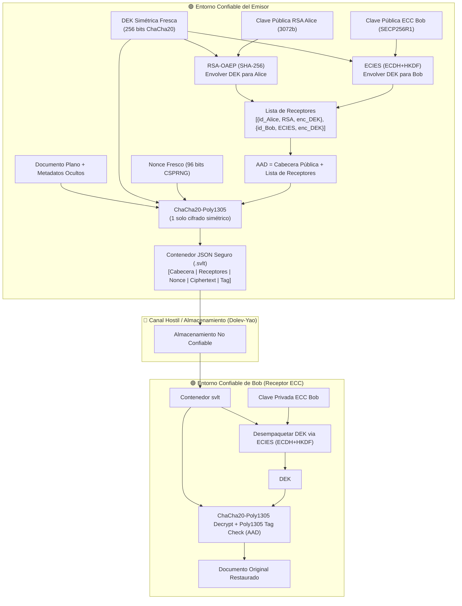

# D3 — Cifrado Híbrido Multireceptor (Multi-Recipient Hybrid Encryption Module)

**Curso:** Criptografía 2027-1 (Grupo 4, Equipo 6)  
**Proyecto:** Secure Digital Document Vault  
**Entrega:** D3 — Cifrado Híbrido Asimétrico/Simétrico con Protección AEAD de Lista de Receptores  
**Extensiones:** Soporte Dual de Key Wrapping: **RSA-OAEP (3072b)** y **ECIES (SECP256R1)**

---

## 1. Visión General del Esquema Híbrido

En la entrega D2 se estableció el cifrado simétrico autenticado individual mediante **ChaCha20-Poly1305**. En esta entrega D3, el sistema evoluciona hacia un **esquema de cifrado híbrido multireceptor**, permitiendo que un documento confidencial sea protegido para múltiples destinatarios autorizados sin duplicar el texto cifrado.

### Principio de Diseño Fundamental
El contenido del archivo se cifra **UNA sola vez** con el algoritmo simétrico de alto rendimiento **ChaCha20-Poly1305** utilizando una clave simétrica fresca denominada **Clave de Cifrado de Documento (DEK / CEK)** de 256 bits. Dicha clave DEK es posteriormente envuelta (*key wrapping*) de forma individual para cada receptor autorizado mediante:
1. **RSA-OAEP (3072 bits, SHA-256):** Criptografía asimétrica clásica robusta para entornos que requieren compatibilidad estándar.
2. **ECIES (Curvas Elípticas SECP256R1 / ECDH + HKDF-SHA256):** Criptografía moderna basada en la sesión del 22 de octubre, que reduce el tamaño de claves en un 92% y la sobrecarga por receptor en un 79%.



---

## 2. Especificación Técnica y Parámetros Criptográficos

| Componente | Primitiva Seleccionada | Parámetros / Estándar | Justificación de Seguridad |
|---|---|---|---|
| **Cifrado Simétrico del Archivo** | ChaCha20-Poly1305 (AEAD) | Clave DEK de 256 bits, Nonce de 96 bits | Cifrado autenticado de alta velocidad resistente a ataques de canal lateral por tiempo y sin necesidad de aceleración hardware AES-NI. |
| **Envoltura Asimétrica 1 (RSA)** | RSA-OAEP | Módulo 3072 bits, Exponente $e=65537$, Hash SHA-256, MGF1 con SHA-256 | Recomendación NIST / BSI para seguridad equivalente a 128 bits posterior a 2030. OAEP previene ataques de oráculo de padding de Bleichenbacher. |
| **Envoltura Asimétrica 2 (ECC)** | ECIES (ISO/IEC 18033-2) | Curva SECP256R1, ECDH efímero, HKDF-SHA256, ChaCha20-Poly1305 | Claves públicas ultra compactas (33 bytes) y forward secrecy efímera con menor latencia computacional. |
| **Identificadores de Receptores** | Fingerprints Deterministas | SHA-256 del bloque ASN.1 DER `SubjectPublicKeyInfo` (SPKI) | Identificación unívoca de claves públicas (RSA y ECC) sin colisiones ni fuga de identidades privadas. Formato estándar RFC 5280. |
| **Protección de la Lista de Receptores** | Vinculación a AAD (AEAD) | Inclusión canónica de `header` y `recipients` en el AAD de Poly1305 | Evita que un atacante elimine, reordene, modifique o agregue receptores de manera inadvertida. |
| **Generación de Aleatoriedad** | CSPRNG del Sistema Operativo | `os.urandom()`, `secrets`, `generate_private_key()` | Prohíbe estrictamente PRNGs débiles (`random` de Python, `rand()` de C). |
| **Límite de Procesamiento** | 256 MiB en memoria | Límite estricto de archivo antes de lectura en memoria | Evita agotamiento de memoria y denegación de servicio (DoS). |

---

## 3. Protección de la Lista de Receptores mediante AAD

En un modelo de atacante **Dolev-Yao**, el adversario puede manipular los campos de un mensaje interceptado. Si la lista de receptores simplemente acompañara al paquete sin autenticación:
- Un atacante podría eliminar la entrada de un receptor legítimo.
- Un atacante podría sustituir una clave cifrada por basura o inyectar receptores arbitrarios.
- Un atacante podría alterar el orden de los receptores.

### Solución Implementada
La lista completa de receptores (identificadores SHA-256 y claves DEK envueltas en Base64), junto con los metadatos de cabecera, forma parte de los **Datos Autenticados Adicionales (AAD)** entregados a Poly1305:

$$\text{AAD} = \text{JSON}_{\text{canónico}}(\{ \text{"header"}: \dots, \text{"recipients"}: [\dots] \})$$

Si un adversario modifica un solo bit del identificador o de la clave envuelta de cualquier receptor, o si agrega o elimina una entrada, la verificación del tag Poly1305 fallará inmediatamente durante el descifrado simétrico para **todos** los receptores.

---

## 4. Estructura del Contenedor Híbrido (`.svlt`)

El archivo resultante es serializado en JSON canónico, admitiendo receptores RSA y ECIES:

```json
{
  "header": {
    "format": "SecureVault-Hybrid",
    "version": "1.0",
    "algorithm": "ChaCha20-Poly1305-Hybrid"
  },
  "recipients": [
    {
      "recipient_id": "3a8f1b6... (SHA-256 de SubjectPublicKeyInfo DER)",
      "scheme": "RSA-OAEP-SHA256",
      "encrypted_key": "base64(RSA_OAEP_SHA256(DEK))"
    },
    {
      "recipient_id": "7c9d0e2... (SHA-256 de SubjectPublicKeyInfo DER)",
      "scheme": "ECIES-SECP256R1",
      "encrypted_key": "base64(ciphertext_DEK)",
      "ephemeral_public_key": "base64(ephemeral_point_SEC1)",
      "nonce": "base64(nonce_96bits)",
      "tag": "base64(tag_128bits)"
    }
  ],
  "nonce": "base64(nonce_96bits)",
  "ciphertext": "base64(payload_cifrado)",
  "tag": "base64(tag_poly1305_128bits)"
}
```

> **Nota de Confidencialidad:** El payload cifrado encapsula internamente la longitud de metadatos, los metadatos sensibles (`filename`, `timestamp` UTC ISO y `plaintext_size`), seguidos del flujo íntegro del archivo plano. Los metadatos no son visibles para observadores externos en el canal hostil.

---

## 5. Política Fail-Closed y Prevención de Oráculos (AD-08 / SR-10)

Ante cualquier anomalía durante el ciclo de vida de validación y descifrado:
1. **Validación de esquema y decodificación:** Si el JSON está malformado o faltan claves requeridas, se genera una excepción `InvalidContainerError` sin procesar criptografía.
2. **Autorización:** Si la clave privada suministrada no corresponde a ningún `recipient_id` presente en el contenedor, se aborta inmediatamente con `UnauthorizedRecipientError`.
3. **Desenvoltura RSA-OAEP / ECIES:** Si la clave privada es incorrecta o los bytes están dañados, el desencapsulado falla levantando `KeyUnwrapError`. No se entrega ningún mensaje detallado que permita distinguir errores de formato interno (prevención de oráculo de padding).
4. **Integridad AEAD:** Si el tag Poly1305, el ciphertext o el AAD (cabecera o lista de destinatarios) no coinciden, se levanta `IntegrityError` (compatible con `cryptography.exceptions.InvalidTag`).
5. **Aislamiento en Disco:** La escritura del archivo descifrado se realiza de forma atómica únicamente tras verificar con éxito el 100% de la autenticidad. Nunca se escriben archivos temporales parciales ni se sobreescriben archivos destino por defecto.

---

## 6. Verificación del Suite de Pruebas

El módulo incluye las 5 pruebas de seguridad obligatorias en `tests/test_hybrid.py`, además de las pruebas de interoperabilidad y de ECIES en `tests/test_ecies.py`:

| Identificador | Caso de Prueba | Comportamiento Esperado | Estado |
|---|---|---|---|
| **Test 1** | Dos receptores autorizados descifran el mismo archivo | Ambos destinatarios con pares RSA independientes recuperan el texto plano exacto a partir del mismo paquete cifrado una sola vez. | ✅ APROBADO |
| **Test 2** | Receptor no autorizado no puede descifrar | Un usuario no incluido en el paquete genera `UnauthorizedRecipientError` sin liberar datos ni escribir en disco. | ✅ APROBADO |
| **Test 3** | Modificación de un elemento en la lista de receptores causa fallo de autenticación AAD | Alterar un byte de la clave envuelta de Bob provoca que Alice detecte fallo de autenticación (`IntegrityError` / `InvalidTag`) al descifrar. | ✅ APROBADO |
| **Test 4** | Clave privada RSA incorrecta impide recuperar la clave simétrica | Intentar descifrar una entrada ajena con una clave privada distinta falla de manera segura en OAEP con `KeyUnwrapError`. | ✅ APROBADO |
| **Test 5** | Eliminación de una entrada de receptor rompe acceso e integridad | Remover a un receptor altera el AAD; los receptores restantes fallan en la verificación Poly1305 (`IntegrityError`). | ✅ APROBADO |
| **Test ECIES** | Cifrado y descifrado multireceptor con ECIES | Receptores con claves de curva elíptica SECP256R1 descifran el contenedor de forma transparente. | ✅ APROBADO |
| **Test Mixto** | Receptores mixtos RSA + ECC en el mismo paquete | Un destinatario RSA y un destinatario ECIES descifran el mismo archivo sin interferencias. | ✅ APROBADO |

### Ejecución de Pruebas

```bash
# Ejecutar suite completa (29 pruebas unitarias y de seguridad)
pytest -v
```

---

## 7. Ejemplo de Uso

### Ejemplo 1: Cifrado Híbrido con RSA-OAEP (D3 Estándar)
```python
from encryption.hybrid_core import generate_rsa_key_pair, encrypt_hybrid_file, decrypt_hybrid_file

alice_priv, alice_pub = generate_rsa_key_pair(3072)
bob_priv, bob_pub = generate_rsa_key_pair(3072)

encrypt_hybrid_file("documento.pdf", "documento.pdf.svlt", [alice_pub, bob_pub])
metadata = decrypt_hybrid_file("documento.pdf.svlt", "recuperado.pdf", bob_priv)
print(f"Recuperado: {metadata['filename']}")
```

### Ejemplo 2: Cifrado Híbrido con ECIES (Curvas Elípticas SECP256R1)
```python
from encryption.hybrid_core import generate_ec_key_pair, encrypt_hybrid_file, decrypt_hybrid_file

alice_priv, alice_pub = generate_ec_key_pair()
bob_priv, bob_pub = generate_ec_key_pair()

encrypt_hybrid_file("documento.pdf", "documento_ecc.pdf.svlt", [alice_pub, bob_pub])
metadata = decrypt_hybrid_file("documento_ecc.pdf.svlt", "recuperado_ecc.pdf", bob_priv)
print(f"Recuperado con ECIES: {metadata['filename']}")
```
