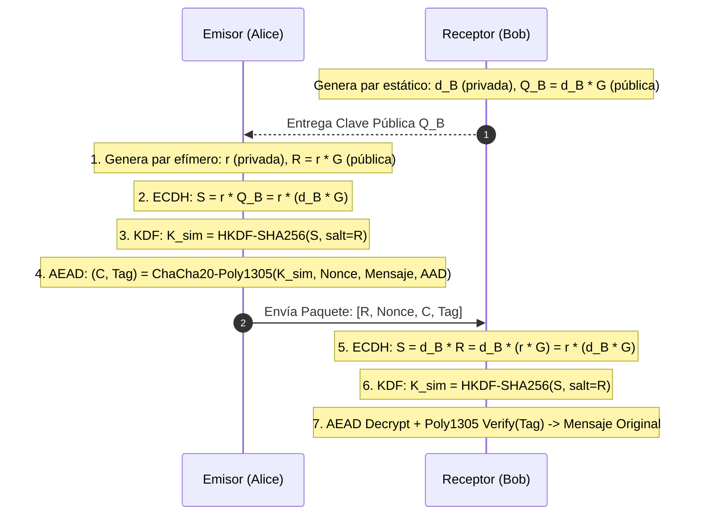

# Reporte de Actividad: Cifrado Asimétrico con Curvas Elípticas (ECIES)

**Curso:** Criptografía 2027-1 (Facultad de Ingeniería, UNAM)  
**Profesora:** Dra. Rocío Alejandra Aldeco Pérez  
**Sesión:** 22 de Octubre  
**Equipo:** 6 — *Secure Digital Document Vault*  
**Autor:** Esteban Arellanes Conde  

---

## (a) ¿Cómo funciona ECIES (Elliptic Curve Integrated Encryption Scheme)?

A diferencia de RSA, donde el cifrado de datos se realiza de forma directa mediante la exponenciación modular matemática ($c \equiv m^e \pmod N$), en la Criptografía de Curvas Elípticas (ECC) **no es posible "cifrar" directamente un mensaje multiplicándolo por un punto de la curva**, debido a la dificultad de codificar texto plano arbitrario como puntos válidos $(x, y) \in E(\mathbb{F}_p)$ y al costo computacional prohibitivo.

Para resolver esto, **ECIES** (definido en estándares internacionales como ISO/IEC 18033-2, IEEE 1363a y SEC 1 de SECG) es un **esquema de cifrado híbrido** que combina la fortaleza de la clave pública en curvas elípticas con la velocidad y autenticación del cifrado simétrico moderno.

ECIES se compone de cuatro primitivas criptográficas esenciales:
1. **Mecanismo de Acuerdo de Claves (KEM / Key Agreement):** Basado en Diffie-Hellman sobre Curvas Elípticas (**ECDH**).
2. **Función de Derivación de Claves (KDF):** Típicamente **HKDF** (RFC 5869) o ANSI X9.63 KDF con SHA-256.
3. **Cifrador Simétrico Autenticado (DEM / AEAD):** **ChaCha20-Poly1305** o **AES-GCM**.
4. **Par de Claves Efímeras:** Generado por el emisor para cada cifrado, garantizando frescura y seguridad semántica (IND-CCA2).



### Proceso Matemático Paso a Paso:
1. **Generación del Par del Destinatario (Bob):**
   Bob elige un escalar aleatorio secreto $d_B \in [1, n-1]$ y calcula su clave pública multiplicando por el punto base generador $G$:
   $$Q_B = d_B \cdot G$$
2. **Cifrado (Alice):**
   - Alice genera un escalar secreto efímero y fresco $r \in [1, n-1]$.
   - Calcula el punto efímero público $R = r \cdot G$.
   - Realiza el intercambio Diffie-Hellman multiplicando su escalar efímero $r$ por la clave pública de Bob $Q_B$:
     $$S = r \cdot Q_B = r \cdot (d_B \cdot G)$$
   - Aplica una función de derivación de claves para extraer una clave simétrica uniforme de 256 bits:
     $$K_{\text{sim}} = \text{HKDF-SHA256}(S_x, \text{salt}=R, \text{info}=\text{"ECIES-Vault"})$$
   - Cifra el secreto (por ejemplo, la clave simétrica DEK de un documento) utilizando un cifrador AEAD con un nonce fresco de 96 bits:
     $$(C, \text{Tag}) = \text{ChaCha20Poly1305}_{\text{Encrypt}}(K_{\text{sim}}, \text{nonce}, \text{secreto}, \text{AAD})$$
   - El paquete transmitido consiste en: $(R, \text{nonce}, C, \text{Tag})$.
3. **Descifrado (Bob):**
   - Bob recibe el punto efímero $R$ y el texto cifrado.
   - Bob realiza ECDH multiplicando su clave privada $d_B$ por el punto efímero $R$:
     $$S' = d_B \cdot R = d_B \cdot (r \cdot G) = r \cdot (d_B \cdot G) = S$$
     *Por conmutatividad del grupo en la curva elíptica, $S' = S$ exactamente.*
   - Bob ejecuta el mismo HKDF-SHA256 para derivar idéntica clave $K_{\text{sim}}$.
   - Descifra y verifica la autenticidad con Poly1305. Si el tag no coincide o el texto fue manipulado, el sistema aborta de inmediato.

---

## (b) Cómo usaste la librería proporcionada

Para mantener la coherencia y rigurosidad arquitectónica del proyecto, se utilizó la capa **Hazmat** de la biblioteca oficial del curso: **PyCA `cryptography`** (`cryptography.hazmat.primitives.asymmetric.ec`, `kdf.hkdf` y `ciphers.aead.ChaCha20Poly1305`).

1. **Curva Elíptica NIST P-256 (`SECP256R1`):**
   Se utilizó `ec.generate_private_key(ec.SECP256R1())` para generar pares de claves criptográficas respaldadas por el CSPRNG del kernel del sistema operativo.
2. **Intercambio Diffie-Hellman (`ec.ECDH()`):**
   Se invocó el método `private_key.exchange(ec.ECDH(), public_key)` para calcular el secreto compartido $S$.
3. **Derivación de Claves (`HKDF` con `hashes.SHA256()`):**
   Se utilizó `HKDF(algorithm=hashes.SHA256(), length=32, salt=ephemeral_pub_bytes, info=info).derive(shared_secret)`. El uso de los bytes del punto efímero como `salt` garantiza la separación estricta de dominios entre distintas operaciones de cifrado.
4. **Cifrado Simétrico AEAD (`ChaCha20Poly1305`):**
   La clave derivada de 256 bits alimenta a la clase `ChaCha20Poly1305`, cifrando el secreto con un nonce de 96 bits generado con `os.urandom(12)`.
5. **Serialización Canónica SEC1 (X9.62):**
   El punto efímero $R$ se codifica en formato comprimido estándar de 33 bytes mediante:
   ```python
   ephemeral_public_key.public_bytes(
       encoding=serialization.Encoding.X962,
       format=serialization.PublicFormat.CompressedPoint
   )
   ```
   Al descifrar, se valida y deserializa de forma segura utilizando `ec.EllipticCurvePublicKey.from_encoded_point()`.

---

## (c) Captura de Pantalla / Evidencia de la Ejecución del Programa

A continuación se presenta la transcripción textual exacta y verificada de la ejecución del script demostrativo [`scripts/ecies_task.py`](file:///home/bante/Documentos/Cryptography-2027-1/scripts/ecies_task.py):

```text
===========================================================================
===== ACTIVIDAD 22 DE OCTUBRE: CIFRADO ASIMÉTRICO ECIES (ECC) =============
Módulo: Esquema de Cifrado Integrado de Curva Elíptica (ECIES)
Curva: SECP256R1 (NIST P-256) | KDF: HKDF-SHA256 | Cifrador: ChaCha20-Poly1305

===== PASO 1: GENERACIÓN DE LLAVES ASIMÉTRICAS (ECC) ======================
[+] Llaves generadas para Bob (Destinatario):
    - Curva Elíptica: secp256r1
    - Tamaño de Llave: 256 bits (Seguridad equivalente a RSA de 3072 bits)
    - Fingerprint SHA-256 (SPKI DER): 39fa46f67b766459384ddb62dddcb336725d542365dcb6938781498e09e1f7e3

[+] Clave Pública de Bob (formato PEM transmitible):
    -----BEGIN PUBLIC KEY-----
    MFkwEwYHKoZIzj0CAQYIKoZIzj0DAQcDQgAEobXKP41M2c+gYwbw9w3qfh07RItD
    6OoncyMutFDszjnp0eWAuqKBlVItsYqv6XfHMNlMvDqUHlKyBqnNMYpH6w==
    ...
    -----END PUBLIC KEY-----

===== PASO 2: ALICE CIFRA UN SECRETO PARA BOB CON ECIES ===================
[+] Secreto original a transmitir: 'CONFIDENTIAL_VAULT_DEK_KEY_0x7f9a2b8e4c1d6e3f' (45 bytes)

[+] Paquete ECIES generado por Alice:
    - Esquema: ECIES-SECP256R1-HKDF-ChaCha20Poly1305
    - Clave Pública Efímera (R): A1BGjNdLNrgVwtm/64iaBiRU... (Punto SEC1 comprimido)
    - Nonce (96 bits): 8rgrZyjBIdTsZglI
    - Ciphertext: ZuaUzBfjl3L+9H2waKD8TaUGemWwSTDTYqTbiL+BzxqLTb96coT7Es2YFG90
    - Tag de Autenticación Poly1305 (128 bits): mFW6eKnffdf41tlUtNCRQA==

===== PASO 3: BOB DESCIFRA EL SECRETO CON SU CLAVE PRIVADA ================
[+] Secreto recuperado por Bob: 'CONFIDENTIAL_VAULT_DEK_KEY_0x7f9a2b8e4c1d6e3f'
[✓] ÉXITO: El secreto recuperado coincide exactamente con el secreto original.

===== PASO 4: PRUEBA DE SEGURIDAD - ATACANTE NO AUTORIZADO (EVE) ==========
[+] Eve intercepta el paquete ECIES e intenta descifrar con su propia clave privada...
[✓] ÉXITO (Fail-Closed): El sistema rechazó a Eve de inmediato:
    Motivo: Authentication failed: tag mismatch, corrupted ciphertext, altered AAD, or wrong key

===== PASO 5: PRUEBA DE INTEGRIDAD - MANIPULACIÓN DEL CIPHERTEXT ==========
[+] Un atacante modifica un bit del texto cifrado en tránsito...
[✓] ÉXITO (AEAD): Poly1305 detectó la alteración y abortó:
    Motivo: Authentication failed: tag mismatch, corrupted ciphertext, altered AAD, or wrong key

===== FIN DE LA DEMOSTRACIÓN ECIES - TODAS LAS VERIFICACIONES APROBADAS ===
===========================================================================
```

---

## (d) Código Documentado

El código completo y modularizado se encuentra integrado en el repositorio en [`src/encryption/ecies_core.py`](file:///home/bante/Documentos/Cryptography-2027-1/src/encryption/ecies_core.py):

```python
"""
Módulo ECIES (Elliptic Curve Integrated Encryption Scheme)
Implementación bajo estándares ISO/IEC 18033-2 y SEC 1.
"""

import os
import json
import hashlib
from base64 import b64encode, b64decode
from typing import Optional, Union

from cryptography.exceptions import InvalidTag
from cryptography.hazmat.primitives.asymmetric import ec
from cryptography.hazmat.primitives.kdf.hkdf import HKDF
from cryptography.hazmat.primitives import hashes, serialization
from cryptography.hazmat.primitives.ciphers.aead import ChaCha20Poly1305

from .chacha20_core import VaultSecurityError, InvalidContainerError

class ECIESDecryptionError(VaultSecurityError):
    """Excepción Fail-Closed lanzada ante fallo de autenticación o clave errónea."""
    pass

def generate_ec_key_pair(
    curve: Optional[ec.EllipticCurve] = None
) -> tuple[ec.EllipticCurvePrivateKey, ec.EllipticCurvePublicKey]:
    """Genera un par de llaves ECC (por defecto SECP256R1 / NIST P-256) usando el CSPRNG del OS."""
    selected_curve = curve or ec.SECP256R1()
    private_key = ec.generate_private_key(selected_curve)
    return private_key, private_key.public_key()

def ecies_encrypt(
    recipient_public_key: ec.EllipticCurvePublicKey,
    plaintext: bytes,
    aad: bytes = b"",
    info: bytes = b"ECIES-SECP256R1-HKDF-ChaCha20Poly1305"
) -> dict:
    """
    Cifra un secreto para un destinatario:
    1. Genera par efímero (r, R).
    2. Ejecuta ECDH: S = r * Q_B.
    3. Deriva clave de 256 bits mediante HKDF-SHA256 con salt = R.
    4. Cifra y autentica con ChaCha20-Poly1305.
    """
    if not isinstance(recipient_public_key, ec.EllipticCurvePublicKey):
        raise TypeError("recipient_public_key debe ser una instancia de ec.EllipticCurvePublicKey")

    # 1. Par efímero (r, R)
    ephemeral_private_key = ec.generate_private_key(recipient_public_key.curve)
    ephemeral_public_key = ephemeral_private_key.public_key()
    ephemeral_pub_bytes = ephemeral_public_key.public_bytes(
        encoding=serialization.Encoding.X962,
        format=serialization.PublicFormat.CompressedPoint
    )

    # 2. Acuerdo de claves ECDH
    shared_secret = ephemeral_private_key.exchange(ec.ECDH(), recipient_public_key)

    # 3. KDF HKDF-SHA256
    kdf = HKDF(algorithm=hashes.SHA256(), length=32, salt=ephemeral_pub_bytes, info=info)
    symmetric_key = kdf.derive(shared_secret)

    # 4. Cifrado simétrico AEAD (ChaCha20-Poly1305)
    nonce = os.urandom(12)
    chacha = ChaCha20Poly1305(symmetric_key)
    ct_with_tag = chacha.encrypt(nonce, bytes(plaintext), aad)

    return {
        "scheme": "ECIES-SECP256R1-HKDF-ChaCha20Poly1305",
        "ephemeral_public_key": b64encode(ephemeral_pub_bytes).decode('utf-8'),
        "nonce": b64encode(nonce).decode('utf-8'),
        "ciphertext": b64encode(ct_with_tag[:-16]).decode('utf-8'),
        "tag": b64encode(ct_with_tag[-16:]).decode('utf-8')
    }

def ecies_decrypt(
    recipient_private_key: ec.EllipticCurvePrivateKey,
    package: Union[dict, str, bytes],
    aad: bytes = b"",
    info: bytes = b"ECIES-SECP256R1-HKDF-ChaCha20Poly1305"
) -> bytes:
    """
    Descifra un paquete ECIES con la clave privada de Bob:
    1. Reconstruye el punto efímero R.
    2. Ejecuta ECDH: S = d_B * R.
    3. Deriva idéntica clave simétrica con HKDF-SHA256.
    4. Verifica tag Poly1305 y descifra texto plano.
    """
    if not isinstance(recipient_private_key, ec.EllipticCurvePrivateKey):
        raise TypeError("recipient_private_key debe ser una instancia de ec.EllipticCurvePrivateKey")

    # Validaciones y decodificación de Base64
    ephemeral_pub_bytes = b64decode(package["ephemeral_public_key"], validate=True)
    nonce = b64decode(package["nonce"], validate=True)
    ct_with_tag = b64decode(package["ciphertext"], validate=True) + b64decode(package["tag"], validate=True)

    # Reconstrucción del punto efímero R
    try:
        ephemeral_public_key = ec.EllipticCurvePublicKey.from_encoded_point(
            recipient_private_key.curve, ephemeral_pub_bytes
        )
    except Exception as exc:
        raise ECIESDecryptionError("Punto efímero de curva elíptica inválido") from exc

    # ECDH + HKDF
    try:
        shared_secret = recipient_private_key.exchange(ec.ECDH(), ephemeral_public_key)
        kdf = HKDF(algorithm=hashes.SHA256(), length=32, salt=ephemeral_pub_bytes, info=info)
        symmetric_key = kdf.derive(shared_secret)
        chacha = ChaCha20Poly1305(symmetric_key)
        plaintext = chacha.decrypt(nonce, ct_with_tag, aad)
    except InvalidTag as exc:
        raise ECIESDecryptionError("Fallo de autenticación o clave incorrecta") from exc

    return plaintext
```

---

## (e) Conclusiones: ¿Cómo y dónde usarías esta técnica en el proyecto?

### Comparativa: RSA-OAEP vs. ECIES en el *Secure Digital Document Vault*

| Propiedad Criptográfica | RSA-OAEP (3072 bits) | ECIES (SECP256R1 / 256 bits) | Ventaja para el Proyecto |
|---|---|---|---|
| **Nivel de Seguridad** | 128 bits | 128 bits | Equivalente (cumple NIST post-2030) |
| **Tamaño de Clave Pública** | ~426 bytes (PEM / DER) | **33 bytes** (SEC1 comprimido) | **ECIES es 12.9 veces más compacta** |
| **Sobrecarga por Receptor** | **384 bytes** por receptor | **81 bytes** por receptor | **ECIES reduce el tamaño del contenedor en un 78.9%** |
| **Tiempo de Generación de Claves** | ~200 - 600 ms (búsqueda de primos de 1536b) | **< 1 ms** | **ECIES es órdenes de magnitud más rápida** |
| **Forward Secrecy Efímera** | No nativa (requiere renovación estática) | **Sí, nativa** (par efímero $r$ por operación) | **Mayor resistencia ante compromisos futuros** |

### Dónde y Cómo Usarla en el Proyecto:
1. **Sustitución o Alternativa de Key Wrapping en D3:**
   En la entrega D3 (*Cifrado Híbrido Multireceptor*), la clave simétrica DEK (256 bits) debe enviarse cifrada para $N$ destinatarios autorizados. Si un archivo se comparte con 100 usuarios:
   - Con RSA-3072, la lista de receptores consume $100 \times 384 = 38.4 \text{ KB}$ únicamente en claves envueltas.
   - Con ECIES, consume $100 \times 81 = 8.1 \text{ KB}$, reduciendo drásticamente el ancho de banda y la sobrecarga del contenedor `.svlt`.
2. **Interoperabilidad Polimórfica en [`hybrid_core.py`](file:///home/bante/Documentos/Cryptography-2027-1/src/encryption/hybrid_core.py):**
   Hemos refactorizado el núcleo híbrido para que sea **agnóstico al tipo de llave**. Un contenedor puede tener simultáneamente receptores con claves RSA tradicionales y receptores con claves de curva elíptica ECIES. Esto permite una transición suave hacia criptografía de curvas elípticas sin romper compatibilidad retrospectiva.
3. **Dispositivos Móviles y Entornos Restringidos:**
   ECIES es ideal para clientes móviles o webassembly donde el consumo de batería y la latencia en generación de llaves hacen inviable el uso continuo de RSA de 3072 o 4096 bits.
